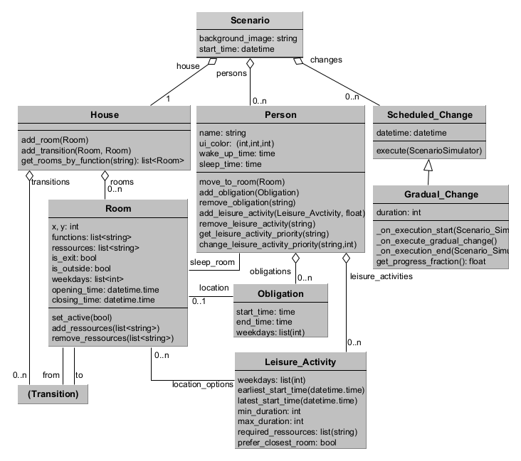

# Scenario Configuration - Documentation   

This file documents how a simulation scenario can be set up using the exemplar. An overview of the involved classes can be found in the following image:



In the following, we discuss different aspects of the setup

## The Scenario
The top level scenario consists of a house, a set of persons and a set of changes. The house represents the environment in which the persons move around. Each person moves around a house according to a daily schedule. Changes can be executed at specific moments in time to change this setup.

The scenario can be further configured to show a background image (which is shown as background in the visualization) and a start time (which determines the date and time the scenario simulation starts).

Occupancy of the house is simulated by moving persons around according to their schedule. Each room will be simulated as a single occupancy sensor that reports true, if there is at least one person in the room and false if not. 

The simulation time is discrete with minute intervals, starting at start_time. Once the simulation passes the time points defined in a scheduled change, the change is executed.


## The House

A house represents the environment through which the persons move. It consists of a graph of rooms and transitions. The class Transition in the class diagram above, is illustrative. The actual transitions are recorded in an adjacency-list. 

Rooms are decorated with a number of attributes that define how they are visualized and behave in the simulation. X and y coordinates define where in the visualization the room is drawn.

Each room has a list of functions and ressources. These can be used to filter / select rooms. An example for a function is "BATHROOM". The house provides a method $get\_room\_by\_function$ that allows querying all rooms of a certain function. Ressources in a room are there to synchronize different activities. A ressources used by one activity cannot be used by another.

Each room has two boolean properties $is\_exit$ and $is\_outside$. Exits are used when the user leaves the house (signified by the position being None). In this case, the person walks to an exit before disappearing. Outside rooms are still considered part of the simulation, but are affected by weather, which can influence their likelihood of being chosen.

Rooms also have date and time-based attributes $weekdays$, $opening_time$ and $closing_time$ that can be used to define restrictions on when a room is available for leisure activities. 

The below code exemplifies the code for assembling a simple house with two rooms and a transition between them.

```
house = House()
bedroom = Room(name = "Bedroom", x = 663, y = 490, functions = [Room.FUNCTION_SLEEP])
office = Room(name = "Office", x = 100, y = 370, ressources=["PC"])

house.add_room(bedroom)
house.add_room(office)
house.add_transition(bedroom, office)
```


## Persons
A person is the main concern of the simulation. Each person moves between rooms based on their daily schedule. The daily scheduls is assembled from the following configurations.

Between $sleep\_time$ and $wakeup\_time$ the person is expected to be asleep in their assigned $sleep\_room$. The simulation assumes that sleep time is in the evening before 23:59 and wakes up after 00:00. 

Obligations are activities that the person needs to take. They happen on specific $weekdays$ between $start\_time$ and $end\_time$. During this time the person is located within the $location$ of the obligation. Obligations have a higher priority than sleep times. If a person has an obligation before their natural sleep time, they wake up for the obligation.

While a person is awake and not occupied with an obligation they choose between a set of leisure activities. At a specific moment, the set of leisure activities that can be chosen from are determined by the specific date and time (it has to be the correct $weekday$ and the current time needs to be between $earliest\_start\_time$ and $latest\_start\_time$). Each leisure activity comes with a set of location options it can pick between. It is only able to choose locations that have the right ressources available ($required\_ressources$). If no such room exists, teh activity is not selectable. If multple rooms exist and $prefer\_closest\_room$ is set, the closest room (least room transitions on the path from the current person position) is chosen. Else, a random room is chosen.

Leisure activities are associated with a priority, with priorities for the same activity potentially differing between persons. The priority is tracked within the person and set via $add\_leisure\_activity()$.


An code example for how to set up a person with one obligation and one leisure activity is below.

```
work = Obligation("Work", 
                    start_time= time(7,00), 
                    end_time = time(14,00), 
                    location = office, 
                    weekdays = [0,1,2,3,4])

play = Leisure_Activity("Play Computer Games",
                        location_options = [office], 
                        min_duration=10, 
                        max_duration=60,
                        required_ressources=["PC"])

arny = Person("Arny", 
                (255, 255, 0),
                wake_up_time= time(8,00), 
                sleep_time = time(22,00))
arny.sleep_room = bedroom
arny.add_obligation(work)
arny.add_leisure_activity(play, priority = 10)

scenario.add_person(arny)
```


## Changes

The simulation allows for two types of changes to be implemented, depending on whether a change happens immediately, or gradually. 

A $Scheduled\_Change$ is a change that is executed at a particular point in time (determined by attribute $datetime$). When this time is passed by the simulation, the function $execute$ is called. Out of the box, the simulation supports the following changes:
- $Leisure\_Activity\_Add$: adds a leisure activity to a person.
- $Leisure\_Activity\_Remove$: removes a leisure activity from a person.
- $Move\_In\_Change$: adds a person to the household.
- $Move\_Out\_Change$: removes a person from the household.
- $Obligation\_Add\_Change$: adds an obligation to a person.
- $Obligation\_Remove\_Change$: removes an obligation from a person.
- $Room\_Activation\_Change$: Enables activating / deactivating rooms.
- $Room\_Ressource\_Change$: Changes the ressources of a room by adding / removing some.

It is also possible to implement custom changes by implementing the $Scheduled\_Change$ superclass. One thing to note is that some changes require a refresh of the visualization component due to the way drawing is optimized. Any changes that involve changing or deactivating rooms and how they are connected, should be accompanied by calling $simulator.notify\_visualization\_refresh\_needed()$ in order to update the visualization.

A $Gradual\_Change$ represents a change that happens gradually over a number of days (attribute $duration$). Out of the box, the simulation provides one gradual change:
- $Gradual\_Leisure\_Activity\_Priority\_Change$: changes the priority of a leisure activity gradually over a number of days.

Custom implementations of the gradual change superclass can be used to implement other changes. For this, the following functions can be implemented:
-  $\_on\_execution\_start()$ is called when the change is started. 
-  $\_on\_execute\_gradual\_change()$ is called at the beginning of each day while the change is ongoing. During this time $get\_progress\_fraction$ can be used to get a numeric representation of the fraction of progress of the change.
- $\_on\_execution\_end()$ is called when the change is ended.


A source code example for adding changes to a scenario can be found below:

````
betty = Person("Betty", 
                (0, 255, 255),
                wake_up_time= time(9,00), 
                sleep_time = time(21,00))

betty_move_in = Move_In_Change(
                datetime = datetime(year = 2021, month = 9, day = 2, hour = 0, minute = 0), 
                person = betty)
scenario.changes.append(betty_move_in)

play_less = Gradual_Leisure_Activity_Priority_Change( 
                datetime= datetime(year = 2020, month = 7, day = 1, hour = 0, minute = 0),
                duration =  10, 
                person = arny,
                activity_name = play.name,
                start_priority = 10,
                end_priority = 5)
scenario.changes.append(play_less)
````