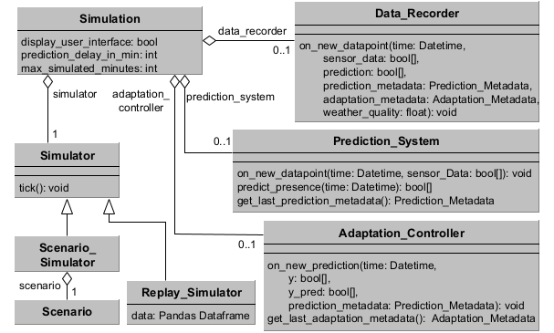

# Scenario Setup - Documentation   


This file documents how a simulation scenario can be set up using the exemplar. An overview of the involved classes can be found in the following image:




In the following, we discuss different aspects of the setup

# Simulation
The simulation is the main class that configures how the simulation environment should be run. A simulation can be configured with the following parameters:
- $display\_user\_interface()$ tells the simulation whether or not occupancy should be visualized. If visualization is active a Pygame window will be shown that displays the scenario, rooms, person locations and predicted occupancy. Since the visualization slows down the simulation in order to make it visually legible, it is recommended to not use a visualization during data recording runs.
- $prediction\_delay\_in\_minu$ defines how many minutes ahead a prediction is done. For example, setting this parameter to 60 means that the prediction is done one hour ahead. From the point of view of prediction, this means the predictor knows actual presence until one hour before the predicted timepoint.
- $max\_simulated\_minutes$ defines how many minutes the simulation should simulate. After the given number of simulation cycles is passed, the simulation will terminate.

A simulation needs to be configured with a $Simulator$ and can optionally be connected to a $Data\_Recorder$, $Prediction\_System$ and $Adaptation\_Controller$. These components are descirbed below.

Once configured, the simulation can be ran with the $start$ method.

The following code snipped shows how a simulation can be configured and started:
````
simulation = Simulation(display_user_interface = True, 
                        max_simulated_minutes = -1,
                        prediction_delay_in_min = 60,
                        random_seed= 42)
simulator = (...)
simulation.set_simulator(simulator)

simulation.start()
````


# Simulator

A simulator determines the setup of the house and how occupancy is simulated within the house. To be compatible with the simulation, a simulator needs to implement:
- $get\_background\_image(): a function telling the simulation which background image to diplay in it's user interface. The background image will usually be a blueprint of the simulated house on which the rooms can be drawn.
- $get\_rooms()$ a function defining the rooms that are part of the simulation and for which occupancy is recorded and predited.
- $get\_start\_time()$: the date and time at start of the simulation.
- $tick()$: is called to advance the simulation by one minute.
 

## Scenario Simulator

The scenario simulator is configured via a $Scenario$ containing a house, set of persons and a set of changes that will be executed at predefined times. Details on how the scenario can be configured can be found in [scenario_configuration.md](scenario_configuration.md). An example for how a scenario can be configured with this domain model can be found in $examples/simple\_scenario$.

The following code snipped shows how a scenario simulator can be set up based on a function $create\_scenario$ that sets up the scenario:
````
scenario = create_scenario()
simulation.set_simulator(scenario_simulator)
````


## Replay Simulator
The replay simulator can be used to replay a recorded dataset. This can be used to integrate real smart home data, or previously recorded simulation data into the simulation framework. An example for how the replay simulator can be used can be found in $examples/data\_loading$.

The following code snipped shows how a replay simulator can be set up:

````
data = External_Data_Loader_.load_data()

bedroom = Room(name = "Bedroom", x = 663, y = 490, functions = [Room.FUNCTION_SLEEP])
office = Room(name = "Office", x = 100, y = 370, ressources=["PC"])
rooms = [bedroom, office]

simulator = Replay_Simulator(rooms= rooms, 
                                data = data,
                                background_image= "path/to/image.png",
                                start_date= datetime(year = 2025,month=11, day = 14, hour = 8),
                                )
simulation.set_simulator(simulator)
````

# Prediction System

The prediction system is responsible for predicting occupancy within the simulated house. For this, the class $Prediction\_System$ can be implemented to include a Machine Learning model. The interface to the simulation consists of the following functions, which can be overwritten for custom implementations:
- $on\_new\_datapoint$: is called whenever there is new sensor data for a specific time point. If the model is sensitive to previous occupancy values, this function can be implemented to get notified of them.
- $predict\_presence$: is the main prediction function. It is expected to return a boolean for each room that represents the predicted presence. Order in the returned values should be the same room order as in the attached simulator's get_rooms function.
- $get\_last\_prediction\_metadate$: returns the metadata of the last prediction cycle. The simulation system fills in the prediction time on it's own. If other data should be recorded, this function can be extended to do so.

The example in $examples/simple\_scenario$ showcases how a custom prediction system can be built based on decision tree classifiers. The following code snipped shows how the $Custom\_Predictor$ implementation of a prediction system can be attached to the simulation.

````
prediction_system = Custom_Predictor()
simulation.set_prediction_system(prediction_system)
````


# Adaptation Controller

The adaptation controller is responsible for adapting the prediction system. For this, the class $Adaptation\_Controller$ can be implemented. The interface to the simulation consists of the following functions, which can be overwritten for custom implementations:
- $on\_new\_prediction: notifies the adaptation controller of a new prediction. It contains the actual occupancy ($y$), the predicted occupancy ($y\_pred$) and the metadata of the prediction.
- $get\_last\_adaptation\_metadata$: returns the metadata of the last adaptation cycle. The simulation system fills in the adaptation time on it's own. If other data should be recorded, this function can be extended to do so. 

The example in $examples/simple\_scenario$ showcases how a custom adaptation system, which simply retrains the model once every week, can be imlemented.  The following code snipped shows how the $Custom\_Adaptation\_System$ implementation of a prediction system can be attached to the simulation.
````
adaptation_controller = Custom_Adaptation_Controller()
simulation.set_adaptation_controller(adaptation_controller)
````

# Data Recorder
The $Data\_Recorder$ records data to store it on hard drive into a dataset. The default implementation of the data recorder stores the following columns into a pickled version of a Pandas Dataframe:
- date: the date and time of the data point
- weather: the weather suitability as a floating point number
- prediction_time: the duration of the prediction for the current data point
- adaptation_time: the duration of the adaptation at the current data point
- room_i: the occupation of the room with index $i$. The index refers to the order of rooms defined by the simulators $get_rooms$ method.
- prediction_i: the prediction for the room with index $i$. The index refers to the order of rooms defined by the simulators $get_rooms$ method.

The class can be extended in order to store other features or record them in another format. For this, the following functions can be overwritten:
- $on\_simulation\_start$: is called when the simulation is started, before the first data point is recorded.
- $on\_new\_data$: is called to notify the data recorder of a new datapoint. 
- $compile\_data$: is compiling the data into a dictionary that will be stored. The function can be extended in cases where additional columns should be added.
- $on\_simulation\_end$: is called when the simulation is finished. It's default behaviour is to call $combine\_data$ and store the result as a Pandas Dataframe via the pickle library. It can be overridden to change this behaviour.

An example for a simulation scenario with an extended data recorder can be seen in $examples/simple\_scenario$. The following code snipped shows how a data recorder can be attached to the simulation:

````
data_recorder = Data_Recorder("path/to/dataset.pickle")
simulation.set_data_recorder(data_recorder)
````


