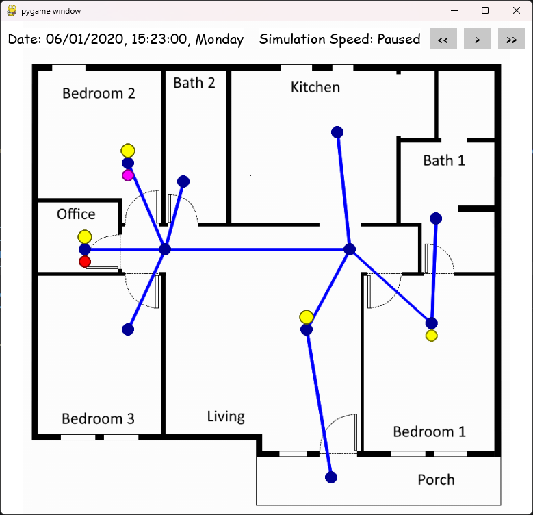

# Visualization

This file documents the visual interface of the visualization. The main purpose of the visualization is to observe and debug scenarios. Since the visualization slows down the calculation, it is recommended to not have it active while recording datasets.

In this file, we give on overview of how to activate the visualization and how to read it.

# Starting the visualization
The visualization is started via the attribute *display_user_interface* of the simulation. By setting it to $True$ the visualization can be started.

An example for how to configure this is given in the following source code: 
````
scenario = create_simple_scenario()
simulation = Simulation(display_user_interface = True)
scenario_simulator = Scenario_Simulator(scenario, simulation) 
simulation.set_simulator(scenario_simulator)
simulation.start()
````

The source code is based on the simple scenario (located in folder *examples/simple_scenario*). It loads the simple scenario and runs a simulation to visualize it.

# Reading the visualization
An example screenshot of the visualization of the simple scenario (located in folder *examples/simple_scenario*) is depicted in the image below. 



The background image of the room blueprint is scenario-specfic and needs to be supplied as an image via the simulator. Overlayed over the image, the visualization draws the graph of rooms and transitions in blue. The coordinates of the room are taken from the respective room objects.

Persons are tracked as colored dots and drawn underneith the room they reside in. Predicted presence is drawn above each room as a yellow dot. In the example above, there is one person in the office and one in Bedroom 2, while occupancy is predicted within Office, Bedroom 2, living room and Bedroom 1.

Simulation information and control is displayed above the blueprint. In the top left corner, the visualization draws the current date and time. The top right corner contains speed controls, with the ability to speed up, slow down and pause the simulation.


