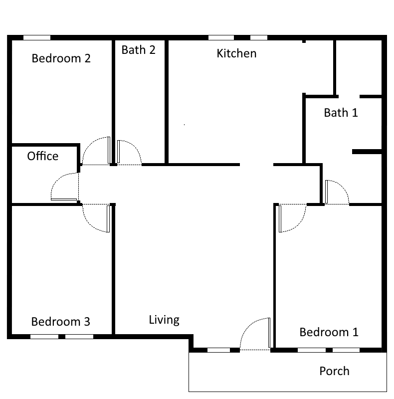

# Scenario Purpose

This scenario illustrates how to define a complete scenario for the simulation, including data recording, prediction via a Machine Learning model and adaptation of the model. 

# Useage

The scenario can be started as a module via *python -m examples.simple_scenario.main <execution_mode>* from the main folder of the project.

Execution mode can have one of three values:
- *RECORD*: runs the simulation for 3 months, recording presence data. Data will be stored in *data/recording.pickle* and can be explored using *data_exploration.ipynb*
- *RUN*:  runs the simulation for 24 months, recording presence data and predictions. Data will be stored in *data/running.pickle* and can be explored using *model_evaluation.ipynb*. The machine learning model is trained on previously recorded data. This data needs to be created by running the scenario in *RECORD* mode at least once.
- *ADAPT*: runs the simulation for 24 months, while adapting. The scenario is the same as in RUN but an additional adpatation controller retrains the model periodically. Data will be stored in *data/adapting.pickle* and can be explored using *adaptation_evaluation.ipynb*. The machine learning model is trained on previously recorded data. This data needs to be created by running the scenario in *RECORD* mode at least once.
- *VIEW*: runs the simulation indefinitely with predictions and a user interface. No data will be recorded.


The project also comes with three Python notebooks to vidualize the data created by the scenario. The following notebooks are available: 
- *data_exploration.ipynb* visualizes the data recorded in execution mode RECORD
- *prediction_evaluation.ipynb* visualizes the predictions recorded with execution mode *RUN*
- *adaptation_evaluation.ipynb* compares the data recorded in execution moes *RUN* and *ADAPT* to visualize the difference of prediction with and without adaptation.

# The Scenario:

Here we describe a short summary of the scenario.
The source code defining this scenario can be found in *src/simple_scenario.py*. 


## House and Occupants:

The house consists of 9 rooms with the following layout:


Each room is equipped with one occupancy sensor. The hallway in the center is equipped with two sensors, one on each end. Overall, this results in 11 occupancy sensors. 

Four persons live in the house: 
- Arny and Betty (sleep in Bedroom 1)
- Coline (sleeps in Bedroom 2)
- Dave (sleeps in Bedroom 3)

## Schedules:

Each person has a daily schedule of obligations that differs only between weekday and weekend. Initially, these obligations are as follows:

### Arny Weekday:
| Obligation | Time | Location |
| ---------- | ---- | -------- | 
| Breakfast | 6:00 - 6:30 | Living Room |
| Work       | 7:00 - 14:00 | Office |
| Get kids from school | 14:00 - 15:00 | Outside |
| Prepare Dinner | 16:00 - 17:00 | Kitchen |
| Dinner | 17:00 - 18:00 | Living Room |

### Arny Weekend:
| Obligation | Time | Location |
| ---------- | ---- | -------- | 
| Study | 10:00 - 11:00 | Bedroom 2 |
| Lunch | 12:00 - 13:00 | Living Room |
| Prepare Dinner | 16:00 - 17:00 | Kitchen |
| Dinner | 17:00 - 18:00 | Living Room |


### Betty Weekday:
| Obligation | Time | Location |
| ---------- | ---- | -------- | 
| Work       | 6:00 - 16:00 | Outside |
| Dinner | 17:00 - 18:00 | Living Room |
| Read Bedtime Story | 19:30 - 20:00 | Bedroom 2 |

### Betty Weekend:
| Obligation | Time | Location |
| ---------- | ---- | -------- | 
| Prepare Lunch | 11:00 - 12:00 | Kitchen |
| Lunch | 12:00 - 13:00 | Living Room |
| Piano Practice | 13:00 - 15:00 | Outside |
| Dinner | 17:00 - 18:00 | Living Room |
| Read Bedtime Story | 19:30 - 20:00 | Bedroom 2 |

### Coline Weekday:
| Obligation | Time | Location |
| ---------- | ---- | -------- | 
| Breakfast | 6:00 - 6:30 | Living Room |
| School | 7:00 - 15:00 | Outside |
| Dinner | 17:00 - 18:00 | Living Room |
| Read Bedtime Story | 19:30 - 20:00 | Bedroom 2 |

### Coline Weekend:
| Obligation | Time | Location |
| ---------- | ---- | -------- | 
| Study | 10:00 - 11:00 | Bedroom 2 |
| Lunch | 12:00 - 13:00 | Living Room |
| Dinner | 17:00 - 18:00 | Living Room |
| Read Bedtime Story | 19:30 - 10:00 | Bedroom 2 |


### Dave Weekday:
| Obligation | Time | Location |
| ---------- | ---- | -------- | 
| Breakfast | 6:00 - 6:30 | Living Room |
| School       | 7:00 - 15:00 | Outside |
| Dinner | 17:00 - 18:00 | Living Room |

### Dave Weekend:
| Obligation | Time | Location |
| ---------- | ---- | -------- | 
| Lunch | 12:00 - 13:00 | Living Room |
| Chess Club| 15:00 - 17:00 | Outside |
| Dinner | 17:00 - 18:00 | Living Room |

## Variability: 
The scenario runs from 01.06.2020 for approximately two years. During this time the scenario is subject to the following variability:

### Leisure time:
During periods of leisure time (when no obligation is scheduled) the person picks randomly from a weighted list of leisure activities. Some activities require ressources (e.g., watching TV occupies the TV) which limits choices for others. The priority of activities that happen outside of the house or on the porch is influenced by weather, so that activities on the porch will be less likely during winter or bad weather.

### Cooking time change:
Starting from 02.03.2021, Arny starts and ends cooking Dinner half an hour earlier. This directly changes presence times in the kitchen on every day.

### Daves temporarily leaves.
On 02.06.2021 Dave temporarily leaves the household because he participates in a student exchange. Dave returns on 02.09.2021. This changes presence times for Daves room (Room 3) and any rooms Dave occupies during obligations or leisure times.


### Leisure activity change
On 02.01.2022, Dave changes priority in leisure activities. Instead of playing video games, Dave is learning to cook and practices cooking regularly. This changes the distribution of rooms in leisure times.


## Prediction and Adaptation

Prediction in this scenario is done using a Decision Tree classifier. The classifier predicts occupancy of all rooms concurrently based on the weekday, hour, and minute of the predicted moment. The prediction in execution modes RUN and ADAPT is the same.

The adaptation is run in execution mode ADAPT. It updates the prediction model once per week irrespective of it's performance. The update is done based on a complete retrain from the values of the previous week.


# Project Structure

The project is structured along the following folders:
- *data*: this folder contains the data recorded as part of this scenario.
- *images*: contains images for visualizing the scenario and displaying it in the simulator
- *notebooks*: contains Python Notebooks to visualize the collected data.
- *src*: contains source code.

# Source Code

The source code for creating a simulation scenario can be found in *main.py*. Here we explain the most important lines that run for the ADAPT mode.

The main class that needs to be instantiated for a simulation run is $Simulation$. In this case, we instantiate this class with 

```
simulation = Simulation(display_user_interface = False, 
                        max_simulated_minutes = 24*30*24*60,
                        prediction_delay_in_min = 60,
                        random_seed = 42)
```
This tells the simulation to not without user interface (*display_user_interface*), for a duration of roughly 24 months (*max_simulated_minutes*), and to predict presence 60 minutes into the future ($prediction_delay_in_min$). 

The scenario is also initailized with a $random seed$ of 24. The simulation uses it's own random generated, meaning calls to the random module outside of the simulation will not have an effect on the reproducibility of the simulation run.

Next, create a simulation scenario and attach it to the simulation. This can be done with the following code:

```
scenario = create_simple_scenario()
scenario_simulator = Scenario_Simulator(scenario, simulation) 
simulation.set_simulator(scenario_simulator)
```

Any scenario needs to implement the class $Scenario$. This class contains the house configuration, as well as persons and changes. For this example, the scenario is assembled in function *create_simple_scenario*, which can be found in *src/simple_scenario.py*.

The scenario is added to the simulation by means of a *Scenario_Simulator*. This wrapper is necessary because there are also other ways to generate occupancy data (e.g., shocased in the *data_loading* example.) 


If the simulation is used for recording datasets, a $Data_Recorder$ can be attached. The following code snippet showcases how this can be done:

```
data_recorder = Extended_Data_Recorder("examples/simple_scenario/data/adapting.pickle")
simulation.set_data_recorder(data_recorder)
```

In this case, custom data recorder is attached. The *Extended_Data_Recorder* implements the bae class *Data_Recorder*. It can be found in *src/extended_data_recorder.py*. The extension showcases how it is possible to alter the recorded data. The extended data recorder adds three columns to the recorded data, representing the weekday, hour and minute.

An optional prediction system can be attached to the simulation in order to predict presence within the simulation. If present, the prediction will be shown in the user interface and recorded by the data recorder. In this scenario, the prediction is attached with the following lines of code:

```
prediction_system = Decision_Tree_Predictor()
simulation.set_prediction_system(prediction_system)
```
The $Decision_Tree_Predictor* is located in *src/decision_tree_predictor.py* and implements a prediction based on a decision tree classifier. It implements the base class *Prediction_System*.

If a prediction system is present, an optional adaptation controller can be attached to the simulation to control adaptation of the prediction system. The adaptation controller needs to implement the base class $Adaptation_Controller$. In the scenario, this is done with the following lines of code:

```
adaptation_controller = Simple_Adaptation_Controller()
simulation.set_adaptation_controller(adaptation_controller)
```

The *Simple_Adaptation_Controller* is a simplistic implementation of the adaptation controller that retrains the *Decision_Tree_Predictor* once every week. The implementation can be found in *src/simple_adaptation_controller.py*.